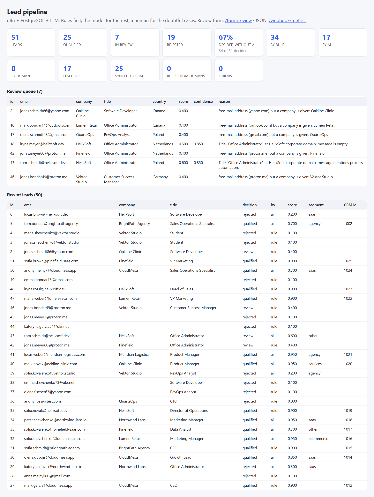
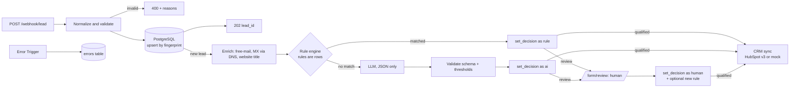

# lead-pipeline-n8n

Inbound lead intake, enrichment, AI qualification and CRM sync on **n8n + PostgreSQL**, built the way I think
automations should be built for production: **rules first, the model only for what is left, a human for the
doubtful cases, an audit trail for every decision, and idempotent by design**.



## What it does

1. **Intake** — `POST /webhook/lead` accepts a lead from any form, landing page or tool. Field aliases are
   normalized (`Email_Address`, `Name`, `Title`…), the email and phone are validated, and the lead is upserted by a
   fingerprint, so re-sends of the same person never create duplicates. Invalid payloads get a `400` with reasons.
2. **Enrichment without paid APIs** — free-mail detection, MX record check through DNS-over-HTTPS, optional website
   title. Plug Clearbit/Apollo/Clay into the same step if you have them.
3. **Rule engine** — rules are rows in PostgreSQL (blocked domains, allow-listed domains, free-mail logic, job-title
   regexes). Most leads are decided here, deterministically and for free.
4. **LLM qualification** — only unresolved leads go to the model (any OpenAI-compatible endpoint: OpenAI, Ollama, or
   the bundled deterministic mock). The answer must match a closed JSON schema; it is validated and mapped to a
   decision through confidence thresholds. Invalid output or low confidence never auto-decides: it goes to a human.
5. **Human in the loop** — `/form/review` lets a person approve or reject a lead; the decision outranks rules and AI
   and can become a new rule, so the same case never needs a human twice.
6. **CRM sync** — qualified leads become contacts through the HubSpot CRM v3 contacts API (search by email, then
   create or update). The bundled mock speaks the same API subset, so `CRM_BASE_URL` is the only switch.
7. **Operations** — a dashboard and a JSON metrics endpoint, an error-handler workflow that stores failures in the
   database, schedules that retry undecided or unsynced leads, optional Slack-compatible notifications.

## Measured on the bundled sample

55 requests (50 fictional leads + 5 near-duplicates with different letter case and spacing), deterministic mock LLM,
mock CRM. Numbers from `v_metrics`, the mock servers' `/stats` and the audit log.

| What | Result |
|---|---|
| Intake of 55 requests | 4.9 s, 50 new leads, 5 duplicates folded into existing rows |
| Decisions | 25 qualified, 7 sent to review, 19 rejected, 0 left undecided |
| Decided by rules, no model involved | **34 of 51 (67%)** |
| LLM calls | **17** = exactly the leads no rule could decide |
| Synced to CRM | 25 contacts, 50 API calls (one search + one create each), 0 errors |
| Same 55 requests sent again | **0 new leads, 0 LLM calls, 0 CRM calls** (idempotent intake, single sync per lead) |
| One human decision through the form | became a `domain_allow` rule; the next lead from that domain was qualified by the rule, **0 LLM calls** |
| Rule guard | a "reject this domain" request for a gmail.com lead was refused: free-mail domains never become rules |
| LLM outage (mock returns 500) | 3 attempts, then the lead lands in review with reason `ai_unavailable`, nothing hangs |
| LLM flaky (every 2nd call fails) | 3 calls, 1 failure, both leads decided normally: retries recover |
| CRM unreachable | the error-handler workflow stored the failure (workflow, node, message); the lead waits for the 15-minute sync retry |

The rule/LLM split depends on your rules and your traffic; the point is that the split is measurable and tunable.

## Architecture



| Workflow | Does | Canvas |
|---|---|---|
| 01 Intake | webhook → normalize/validate (Code) → `upsert_lead()` → 202 → calls 02 for new leads | [screenshot](docs/wf-01-intake.png) |
| 02 Enrich & qualify | per lead: enrichment → rule engine → LLM for the rest → validation → `set_decision()` → calls 03; schedule re-checks undecided leads | [screenshot](docs/wf-02-enrich-qualify.png) |
| 03 CRM sync | search contact by email → create or update → store `crm_id` → optional notification; schedule retries unsynced leads | [screenshot](docs/wf-03-crm-sync.png) |
| 04 Review form | `/form/review`: human decision, optional domain rule (never for free-mail domains) | [screenshot](docs/wf-04-review-form.png), [form](docs/review-form.png) |
| 05 Error handler | `settings.errorWorkflow` of all others: failure → `errors` table → optional notification | [screenshot](docs/wf-05-error-handler.png) |
| 06 Dashboard | `GET /webhook/dashboard` (HTML) and `GET /webhook/metrics` (JSON) from SQL views | [screenshot](docs/wf-06-dashboard.png) |

### Decisions that matter

- **Decisions are protected by priority** — `set_decision()` in SQL only applies a decision if the actor's priority
  (`human` 3 > `rule` 2 > `ai` 1) is at least the current one. A late AI answer can never overwrite a human.
- **Everything is audited by the database, not by the workflows** — triggers on `leads` write `lead_events`
  (created, enriched, decision, crm_synced), so an edit from psql or a future UI is logged exactly like n8n.
- **Rules are data** — adding a blocked domain or a title pattern is an `INSERT`, not a workflow change, and the review
  form inserts rules on behalf of humans.
- **The model is boxed in** — closed segment taxonomy, numeric scores in `[0, 1]`, output validated in code,
  thresholds explicit (`auto-accept at fit ≥ 0.7 and confidence ≥ 0.8`, `reject at fit < 0.4 and confidence ≥ 0.8`,
  otherwise review). The model receives only what it needs: no ids, no raw payload, no last names.
- **Idempotent at every step** — fingerprint upsert at intake, one `ai_called` event per model call, `crm_id` written
  once, schedules that only pick up what is pending.
- **Workflows as code** — `n8n/build.js` declares the six workflows; Code-node logic lives in `n8n/code/*.js` and is
  unit-tested in `tests/` outside n8n; the generated JSON in `n8n/workflows/` is what the setup script imports.
  The repository is the source of truth, not the n8n canvas.

More in [docs/DESIGN.md](docs/DESIGN.md).

## Quick start

Requirements: Docker with Compose v2, Node.js 20+ for the helper scripts. Everything runs offline with the mocks.

```bash
git clone https://github.com/kostyantyn94/lead-pipeline-n8n.git
cd lead-pipeline-n8n
bash scripts/setup.sh            # Windows: powershell -ExecutionPolicy Bypass -File scripts/setup.ps1
node scripts/send_leads.js       # posts samples/leads.csv to the intake webhook
```

The setup script starts PostgreSQL 17, n8n, the mock CRM and the mock LLM, creates the n8n Postgres credential from
`.env`, imports and publishes the six workflows.

| URL | What |
|---|---|
| `POST http://localhost:5678/webhook/lead` | intake (JSON body; see `samples/leads.csv` for the fields) |
| `http://localhost:5678/webhook/dashboard` | dashboard |
| `http://localhost:5678/webhook/metrics` | metrics JSON |
| `http://localhost:5678/form/review` | human review form |
| `http://localhost:5678` | n8n editor (create the owner account on first visit) |
| `http://localhost:8080/stats`, `http://localhost:8081/stats` | mock CRM and mock LLM counters |

Metrics from the database: `docker compose exec -T postgres psql -U n8n -d leads -f /sql/metrics.sql`.

## Switching to real services

Edit `.env` (copied from `.env.example` on first setup) and restart: `docker compose up -d`.

| Service | Variables | Notes |
|---|---|---|
| LLM | `LLM_BASE_URL`, `LLM_API_KEY`, `LLM_MODEL` | any OpenAI-compatible chat-completions endpoint: OpenAI (`https://api.openai.com/v1`, `gpt-4o-mini`), Ollama on the host (`http://host.docker.internal:11434/v1`, `qwen2.5:14b`), … |
| CRM | `CRM_BASE_URL=https://api.hubapi.com`, `CRM_TOKEN` | HubSpot private app token with `crm.objects.contacts.read` and `.write`; standard properties only, the pipeline's reason and opener go into `message` |
| Notifications | `NOTIFY_WEBHOOK_URL` | any Slack-compatible incoming webhook (`{"text": "..."}`) |
| Enrichment | `ENRICH_WEBSITE=true` | also fetch the company homepage title (slower) |
| ICP | `ICP_DESCRIPTION` | the ideal customer profile the model scores against |

## Repository layout

```
db/            schema (tables, triggers, set_decision, upsert_lead, views) and seed rules; applied on first start
docker-compose.yml, .env.example
n8n/build.js   workflows as code → n8n/workflows/*.json
n8n/code/      Code-node logic (pure functions, unit-tested)
n8n/credentials/postgres.template.json   rendered from .env by the setup script, never committed
mock/          mock CRM (HubSpot v3 subset) and mock LLM (OpenAI shape), Node built-ins only
samples/       55 fictional leads; regenerate with `npm run gen:leads`
scripts/       setup.sh / setup.ps1, send_leads.js, gen_leads.js, n8n_push.js (dev), sql/metrics.sql
tests/         node --test: intake, rule engine, AI validation, CRM mapping, review guard, dashboard, build
docs/          screenshots and DESIGN.md
```

## Development

```bash
npm test                 # unit tests, no Docker needed
npm run build            # regenerate n8n/workflows/*.json from n8n/build.js and n8n/code/
N8N_EMAIL=... N8N_PASSWORD=... node scripts/n8n_push.js n8n/workflows/02-enrich-qualify.json   # push an update to a running n8n
docker compose down -v   # start over
```

`n8n import:workflow` only creates workflows that do not exist yet; `scripts/n8n_push.js` updates and re-activates
existing ones through n8n's REST API.

## Known limits

- Enrichment is deliberately free (DNS, homepage title). Real enrichment providers plug into workflow 02.
- Thresholds and the segment taxonomy are constants in `n8n/code/validate_ai.js`; the mock LLM is a heuristic, so its
  scores say nothing about a real model's quality.
- The dashboard and the form have no authentication: keep them behind n8n's auth or a reverse proxy in production.
- Single-tenant by design; multi-tenant would add a `tenant_id` to the tables and the rules.

Built and tested with n8n 2.42, PostgreSQL 17, Node 22. MIT license.
